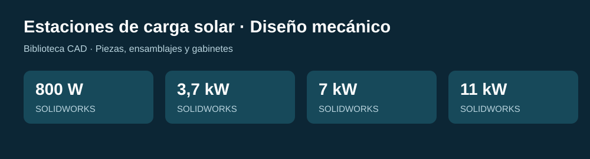
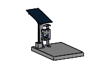

# Estación de carga solar — Diseño mecánico

Repositorio de los diseños mecánicos de estaciones de carga solar. Incluye las cuatro variantes identificadas en la entrega original, sus piezas, ensamblajes, gabinetes y archivos ZIP internos.

Las denominaciones de potencia se conservan como identificadores de los diseños; no constituyen una verificación de la potencia eléctrica de carga.

## Vista del modelo de 800 W

Vista previa extraída del propio archivo SOLIDWORKS (145 × 105 píxeles). La entrega no incluye renders independientes de las otras variantes.

## Abrir los diseños

| Variante | Ensamblaje principal |
| --- | --- |
| 800 W | [Carport_800WCompleto_FINALISIMO.SLDASM](disenos/Dise%C3%B1o%20CAD%20Estaciones%20de%20Carga/800WfinalFinalisimo/800WfinalFinalisimo/Carport_800WCompleto_FINALISIMO.SLDASM) |
| 3,7 kW | [Carport_3k7W.SLDASM](disenos/Dise%C3%B1o%20CAD%20Estaciones%20de%20Carga/3.7k%20Final/3.7k%20Final/Carport_3k7W.SLDASM) |
| 7 kW | [Estacion_7kW con Gabinete.SLDASM](disenos/Dise%C3%B1o%20CAD%20Estaciones%20de%20Carga/7k%20Final/7k%20Final/Estacion_7kW%20con%20Gabinete.SLDASM) |
| 11 kW | [Estacion_11kW con Gabinete.SLDASM](disenos/Dise%C3%B1o%20CAD%20Estaciones%20de%20Carga/11k%20final/11k%20final/Estacion_11kW%20con%20Gabinete.SLDASM) |

1. Descarga o clona el repositorio completo. El ZIP original, incluidos los cuatro ZIP internos, está disponible en [la versión de entrega](https://github.com/mecatronicosolar/estacion-carga-solar-diseno-mecanico/releases/tag/cad-2026-11-19).
2. Conserva la estructura de carpetas y abre el ensamblaje principal en una versión compatible de SOLIDWORKS.
3. Si SOLIDWORKS solicita componentes, busca en la carpeta de la variante, su gabinete y `Gabinete General`. La resolución de referencias debe comprobarse en SOLIDWORKS.

## Contenido

- [Diseños CAD originales](disenos/): 418 archivos CAD extraídos del ZIP entregado, con sus nombres y rutas conservados.
- [Gabinete general](disenos/Dise%C3%B1o%20CAD%20Estaciones%20de%20Carga/Gabinete%20General/): piezas compartidas del gabinete y conector.
- [Inventario de archivos](docs/inventario.csv): ruta, tamaño y huella SHA-256 para verificar la integridad.
- [Imágenes](docs/imagenes/): portada de documentación y miniatura original del ensamblaje.

### Formatos y versiones

La entrega contiene **385 piezas `.SLDPRT`, 33 ensamblajes `.SLDASM` y 4 ZIP internos**, además de las carpetas originales. Los ZIP internos se conservan dentro de la descarga original: pueden representar estados anteriores del diseño.

El nombre `Estacion_11kW_Completa.step.SLDASM` corresponde a un archivo `.SLDASM`; no se incluye un archivo STEP independiente. No se recibieron planos PDF ni archivos `.SLDDRW`.

## Entrega original y archivos grandes

El [ZIP original completo](https://github.com/mecatronicosolar/estacion-carga-solar-diseno-mecanico/releases/tag/cad-2026-11-19) se conserva como archivo adjunto de la versión `cad-2026-11-19`. Incluye los cuatro ZIP internos sin modificaciones. Los 418 archivos CAD extraídos se publican directamente en las carpetas del repositorio.

## Estado de la entrega

Se verificó la integridad de la extracción frente al ZIP recibido. No se han validado apertura, referencias de ensamblaje, interferencias, materiales ni cálculos estructurales en SOLIDWORKS. Algunos componentes incluyen `CONCEPTUAL` o `ENSAYO` en su nombre; se conservan tal como fueron entregados.
